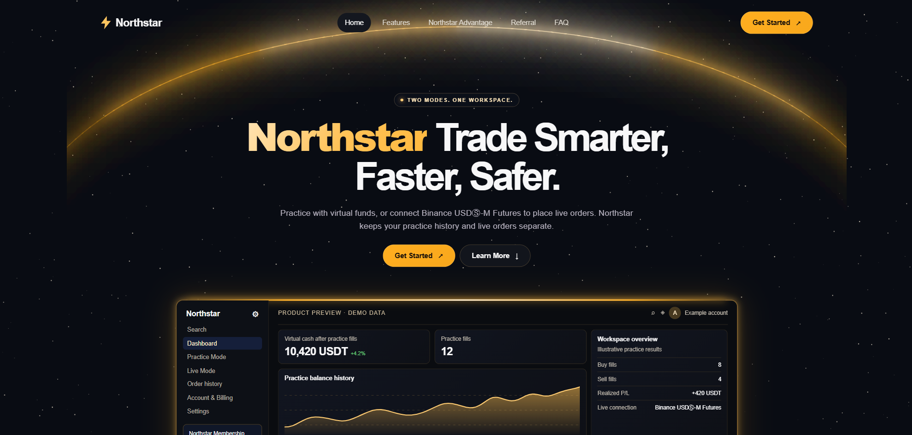

# Trading Bot — Binance Futures Testnet (USDT-M)

## Northstar web workspace

The [Northstar web app](northstar-web/) adds a browser-based workspace with Practice Mode, optional Binance Futures Live Mode, and administration. Start with the [web setup guide](northstar-web/docs/WEB_APP.md) or see the [screenshot gallery](northstar-web/README.md#screenshots).



A small, structured Python CLI application that places **MARKET**, **LIMIT**,
and **STOP_LIMIT** orders on the Binance Futures Testnet, with input
validation, structured logging, and error handling.

## Project Structure

```
trading_bot/
  bot/
    __init__.py
    client.py          # Binance API client wrapper (network/API layer)
    orders.py           # Order placement logic (validation + orchestration)
    validators.py        # Input validation
    logging_config.py    # Logging setup
  cli.py                 # CLI entry point (argparse)
  requirements.txt
  .env.example
  README.md
  logs/                  # Created automatically, holds trading_bot.log
```

## Setup Steps

1. **Create a Binance Futures Testnet account** at
   https://testnet.binancefuture.com and generate API key + secret.

2. **Install Python 3.10+** and clone/unzip this project.

3. **Install dependencies:**
   ```bash
   cd trading_bot
   python -m venv venv
   source venv/bin/activate   # Windows: venv\Scripts\activate
   pip install -r requirements.txt
   ```

4. **Set your API credentials** as environment variables:
   ```bash
   export BINANCE_TESTNET_API_KEY="your_api_key_here"
   export BINANCE_TESTNET_API_SECRET="your_api_secret_here"
   ```
   (See `.env.example`. On Windows use `set VAR=value` or a `.env` loader
   of your choice — credentials are read via `os.environ`, so any method
   that sets the process environment works.)

   Alternatively, pass them directly on the command line with
   `--api-key` / `--api-secret` (not recommended — shell history will
   contain your secret).

## How to Run — Examples

**Market order (BUY):**
```bash
python cli.py --symbol BTCUSDT --side BUY --type MARKET --quantity 0.01
```

**Limit order (SELL):**
```bash
python cli.py --symbol BTCUSDT --side SELL --type LIMIT --quantity 0.01 --price 60000
```

**Stop-Limit order (bonus feature, BUY):**
```bash
python cli.py --symbol BTCUSDT --side BUY --type STOP_LIMIT \
  --quantity 0.01 --price 65000 --stop-price 64500
```

Each run prints:
- The order request summary
- The order response (`orderId`, `status`, `executedQty`, `avgPrice` if available)
- A clear success/failure message

All API requests, responses, and errors are also written to
`logs/trading_bot.log`.

## Design Notes

- **Layered structure:** `cli.py` only parses arguments and prints
  output. `bot/orders.py` validates input and orchestrates the request.
  `bot/client.py` is the only module that talks to Binance. This keeps
  the API layer swappable/testable independent of the CLI.
- **Validation** (`bot/validators.py`) checks symbol format, side,
  order type, and that `price` / `stop_price` are supplied when the
  order type requires them, before any network call is made.
- **Error handling:** `bot/client.py` catches Binance API exceptions
  and network/request exceptions separately, wrapping them in
  `BinanceClientError` / `BinanceNetworkError` so callers can handle
  "bad request" vs. "no connection" differently if needed.
- **STOP_LIMIT** is implemented as Binance's `STOP` order type
  (a stop-limit order: `stopPrice` triggers the order, `price` is the
  resulting limit price).

## Assumptions

- Only **USDT-M Futures** (the `/fapi` endpoints) are used, per the
  assignment scope — no spot or COIN-M support.
- API credentials are supplied via environment variables rather than
  hardcoded, for basic security hygiene.
- `python-binance`'s `Client` is pointed at the testnet by overriding
  `FUTURES_URL`, since the library's built-in `testnet=True` flag only
  targets the Spot Testnet, not Futures Testnet.
- Default `timeInForce` for LIMIT / STOP_LIMIT orders is `GTC`
  (Good-Til-Canceled), since the assignment didn't specify one.
- Logging goes to `logs/trading_bot.log` (created automatically) plus
  the console, at DEBUG and INFO level respectively.
- CLI quantity/price/stop-price are accepted as strings and converted
  to floats during validation, matching how Binance's API expects
  numeric string parameters.

## Sample Log Files

After running at least one MARKET and one LIMIT order against the
testnet, `logs/trading_bot.log` will contain entries for each API
request and response, e.g.:

```
2026-07-22 10:15:03 | INFO     | trading_bot | API REQUEST | futures_create_order | params={'symbol': 'BTCUSDT', 'side': 'BUY', 'quantity': 0.01, 'type': 'MARKET'}
2026-07-22 10:15:03 | INFO     | trading_bot | API RESPONSE | {'orderId': 12345678, 'status': 'FILLED', ...}
```
